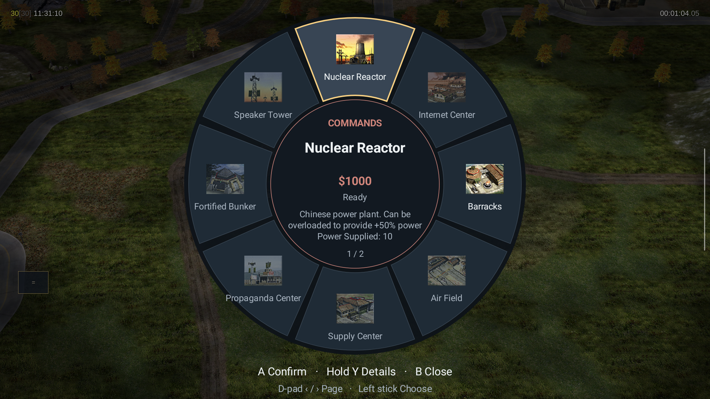
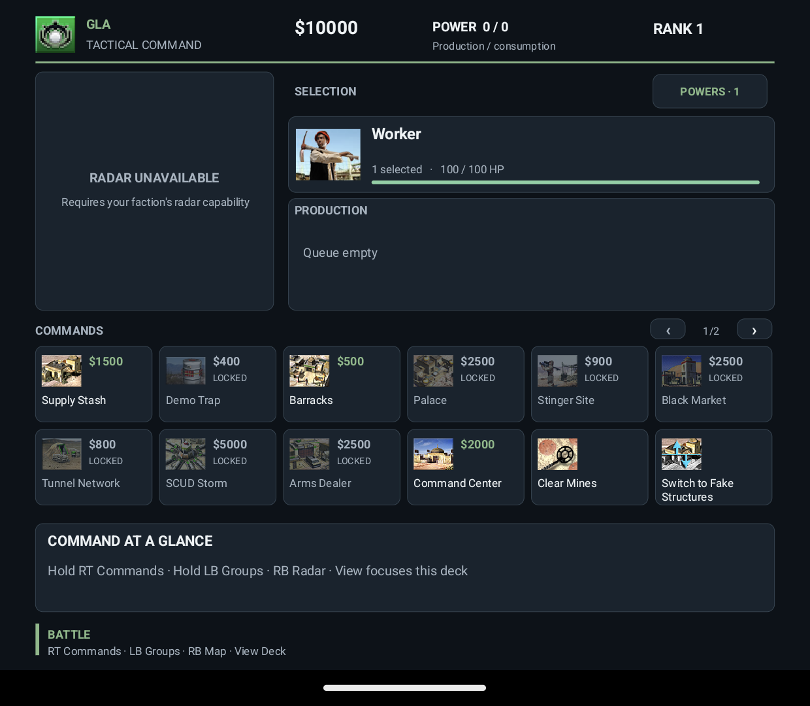

# Thor RTS

I wanted to play Command & Conquer: Generals Zero Hour on the AYN Thor, with
buttons and sticks for control and the second screen for commands. This is the port
I'm building.

The battlefield goes on the top screen. The bottom has your minimap, selected
units, building commands, production queues and General's Powers. Use the sticks
and buttons, touch, or both. It runs natively on Android with the original
30 Hz simulation.

No game files are included. You need your own PC copy of Zero Hour. The Steam
edition is the one tested so far. This is a development preview, currently
**0.1.0-alpha.6**.

[Install guide](docs/HOWTO/THOR_INSTALL.md) · [Full controls](docs/HOWTO/THOR_CONTROLS.md)
· [Build from source](docs/BUILD/THOR.md) · [Report a bug](https://github.com/ROM-HackZ/generals-zero-hour-ayn-thor/issues)

## A few pictures

| Command wheel | Bottom screen |
|---|---|
|  |  |

## Downloads

The desktop app lets you browse to your game folder, choose your Thor and press
Install on Thor. It copies your files over USB and checks them. Interrupted
transfers can resume.

| What you need | Download | Open it |
|---|---|---|
| Windows 10/11, x64 | [Installer EXE](https://github.com/ROM-HackZ/generals-zero-hour-ayn-thor/releases/download/installer-v0.1.0/Thor-RTS-Installer-0.1.0-Windows-x64.exe) | Double-click it. |
| Apple Silicon Mac, macOS 13+ | [Mac ARM64 ZIP](https://github.com/ROM-HackZ/generals-zero-hour-ayn-thor/releases/download/installer-v0.1.0/Thor-RTS-Installer-0.1.0-macOS-arm64.zip) | Unzip it and open Thor RTS Installer.app. |
| Intel Mac, macOS 13+ | [Mac x64 ZIP](https://github.com/ROM-HackZ/generals-zero-hour-ayn-thor/releases/download/installer-v0.1.0/Thor-RTS-Installer-0.1.0-macOS-x64.zip) | Unzip it and open Thor RTS Installer.app. |
| Ubuntu/Debian, x64 | [Linux DEB](https://github.com/ROM-HackZ/generals-zero-hour-ayn-thor/releases/download/installer-v0.1.0/Thor-RTS-Installer-0.1.0-Linux-x64.deb) | Install the package, then open Thor RTS Installer. |
| Other Linux desktops, x64 | [Linux portable folder](https://github.com/ROM-HackZ/generals-zero-hour-ayn-thor/releases/download/installer-v0.1.0/Thor-RTS-Installer-0.1.0-Linux-x64.tar.gz) | Extract it and run `thor-rts-installer`. See the [Linux requirements](docs/HOWTO/THOR_INSTALL.md). |
| Current Android app | [Alpha.6 APK](https://github.com/ROM-HackZ/generals-zero-hour-ayn-thor/releases/download/v0.1.0-alpha.6/Thor-RTS-0.1.0-alpha.6.apk) | Choose this file under Advanced → Local APK in the desktop installer. |

**Installer 0.1.0 automatically downloads alpha.1.** Download the alpha.6 APK
above and choose it under Advanced → Local APK to get the current controls.
For an existing installation, tick App update only. Save your match before updating.

The [installer release](https://github.com/ROM-HackZ/generals-zero-hour-ayn-thor/releases/tag/installer-v0.1.0)
and [app release](https://github.com/ROM-HackZ/generals-zero-hour-ayn-thor/releases/tag/v0.1.0-alpha.6)
include checksums. Windows has been tried with the actual Thor. The Linux UI has
been checked under Ubuntu/WSL; physical Linux USB access and the Mac apps still
need testing. These are unsigned community desktop apps. The install guide
covers the Windows/macOS publisher prompts.

## Getting started

| Step | What to do |
|---|---|
| 1. Get your files | Install Zero Hour on your PC. In Steam, use Manage → Browse local files. Keep the whole folder, including `ZH_Generals`. On a Mac, bring that folder over from your PC. |
| 2. Get the installer and APK | Download the desktop app for your computer and the alpha.6 APK above. |
| 3. Connect the Thor | Enable USB debugging, connect a USB data cable and accept the debugging prompt on the Thor. |
| 4. Pick your paths | Browse to the game folder. Under Advanced → Local APK, choose the alpha.6 APK. Refresh the device list and choose the Thor. The installer can download ADB if you need it. |
| 5. Install | Press Install on Thor. Once it finishes, open Thor RTS on the handheld and press Play. |

You don't need to build the source to play. Your PC game files are read only.
Updating the same signed app keeps its data and saves. Uninstalling removes them.
The [install guide](docs/HOWTO/THOR_INSTALL.md) covers USB setup, offline installs
and backing up saves.

## Controls

These are the default bindings. L3 and R3 mean clicking the left and right sticks.
Camera speed, dead zone, pan/zoom direction, snapping and button remapping are in
Controller settings on the launcher.

### On the battlefield

| Button | What it does |
|---|---|
| Left stick | Pan the camera. |
| Right stick left/right | Rotate the camera. |
| Right stick up/down | Zoom in/out. Up zooms in by default. |
| Hold R3 + right stick | Move the targeting cursor precisely. |
| A | Select a unit, give an order at the cursor, or confirm a target. |
| Double A | Aim at your unit and press twice to select that type on screen. |
| Hold A + pan | Draw a selection box; release A to select. |
| B | Cancel targeting or an unconfirmed building preview; otherwise deselect. |
| X | Attack-move to the cursor. Units engage enemies along the way. |
| Y | Stop the selected units' current orders. They stay selected. |
| LT | Add units to the selection or queue orders as waypoints. |
| L3 | Centre the camera on your selection. |
| LT + L3 | Select on-screen matches for the selected unit types. The cursor can be anywhere. Repeated presses stay screen-only. |
| D-pad Up | Next idle worker/dozer. |
| D-pad Down | Command centre. |
| D-pad Left | Cycle army units. |
| D-pad Right | Cycle production buildings. |
| Start | Pause/menu. |

### Wheels and the bottom screen

| Mode | Choose | Buttons |
|---|---|---|
| Hold RT, command wheel | Left stick highlights a command. D-pad left/right changes page. | A uses it. Hold Y for its full description; D-pad up/down scrolls the description. B closes the wheel. |
| Hold LB, control groups | Left stick highlights a group. D-pad left/right switches between groups 1 to 8 and 9 to 10. | A recalls it. X replaces it with your selection. LT + X adds your selection. Y centres the camera on it. |
| RB, minimap control | Left stick moves the map cursor. | Y looks there. A orders selected units there. B returns to the battlefield. |
| Select/View, bottom-screen controls | D-pad moves between commands, production and Powers. At a row's edge, left/right changes page. | A uses the highlighted control. B or Select/View returns. |
| Menus | D-pad or left stick chooses a control. | A confirms or edits. B goes back. |
| Text entry | D-pad chooses a character. | A types, X deletes, Y accepts, B cancels. |

For a targeted ability, choose it from RT, release RT, aim and press A. B cancels.
The wheel and bottom screen use the game's own commands and checks.

### Placing a building

| Step | Controller action |
|---|---|
| Choose | Select a worker/dozer, choose the building from RT or the bottom screen, then release RT. |
| Pick a spot | Pan the preview into position and press A to lock the site. |
| Face it | Let the left stick return to centre, then point it in the direction you want the building to face. The right stick still rotates/zooms the camera. |
| Build | Press A again to confirm. The game checks the site, money and prerequisites. |
| Cancel | B cancels before confirmation, including during rotation. Choosing a spot and rotating spend nothing. |

With touch, one finger chooses the spot, then the next touch/drag chooses facing.
Use Build or Cancel on the bottom screen to finish. Two-finger camera gestures
remain available. To cancel construction after ordering it, select the unfinished
building itself and use Cancel Construction in RT or the bottom-screen grid.

### Touch

| Where | Gesture | What it does |
|---|---|---|
| Battlefield | One-finger tap | Select or give an order. |
| Battlefield | Double tap on your unit | Select matching units on screen. |
| Battlefield | One-finger drag | Draw a selection rectangle. |
| Battlefield | Two-finger drag | Pan the camera. |
| Battlefield | Pinch / twist | Zoom / rotate. |
| Bottom minimap | Tap / drag | Jump to the touched spot / pan across the touched spots. |
| Selection portrait | Tap | Centre the camera on the selection. |

Adding a second finger cancels an unfinished selection box and starts camera
control. Lift both fingers before starting a new selection. During building or
ability targeting, one finger aims the preview instead of drawing a box.

## Useful stuff

| Task | How |
|---|---|
| Select more of the same unit | Select one, then LT + L3. This avoids having to double-press A with cursor snap. |
| Cancel a queued unit or upgrade | Choose its entry in the bottom-screen production strip. The game handles the cancellation/refund. |
| Cancel an unfinished building | Select that building, then Cancel Construction. |
| Let one passenger out | Select the transport or garrison, then choose that passenger's Exit entry. Each passenger keeps its own button. |
| Sell a building or set its rally point | Select it and choose the command in RT or the bottom-screen grid. Selling asks for confirmation. |
| Buy General's Powers | Open Powers on the bottom screen, choose a power and spend its displayed points. B goes back. |
| Select the army, aircraft or hero | Open Tools on the bottom screen or Tactical tools in RT. |
| Find a busy builder | Tools → Next builder. D-pad Up finds idle builders. |
| Jump to the last alert | Tools → Last alert. |
| Scatter units, make a formation or reset the camera | Open Tools and choose the command. |
| Change cursor snapping or camera controls | Open Controller settings from the launcher. |

The bottom screen also shows health, veterancy, rank progress, construction
progress, reinforcement countdowns and active toggles such as Overcharge.
Radar, fog and powers follow the original game's rules.

## What has been tested

I'm testing this on an actual Thor running Android 13. The observed game rate is
around 30 fps. Longer sessions still need testing.

| Area | Checked so far | Still needs testing |
|---|---|---|
| Displays and input | Both screens, full top-screen output, pan/rotate/zoom, selection, command/group wheels and pages. The revised wheel and deck have been tried by hand. | All group combinations, suspend/reconnect and the single-screen fallback. |
| Skirmish and commands | Skirmish startup/AI play, legal/illegal placement, production, queue refunds, unfinished-building cancellation, independent Ranger exits and Overcharge on/off. | Full campaign/Challenge playthroughs, every ability, timer structures and campaign-specific dialogs. |
| Touch and radar | Selection rectangles, second-finger cancellation, pan/pinch/twist, minimap taps/drags, fog, camera outline, construction alerts and China's radar upgrade. | Every hero/alert in combat and long sessions. |
| Matching selection | Alpha.5 device checks selected both visible dozers with the cursor elsewhere, excluded an off-screen match on repeat and kept plain L3 centring. | Physical shortcut comfort and mixed-type selection. |
| Powers and saves | Power names/points/back navigation, a learned power purchase, saves kept through APK updates and loaded again. | Every power and importing PC saves. |
| Build and installer | Native/APK builds, host input/layout/artwork checks, Windows installation on the Thor and Linux UI under WSL. | Physical Mac/Linux installation and other handhelds. |

Alpha.6 fixes intro frame skipping, briefing skips that
could turn into a delayed pause, the bottom-screen menu layout and the cursor
jumping back to center when A is held. USA 1's missile shots, black-and-white
briefing and narration have now been checked on the Thor too. The camera,
rendering and audio fixes are shared across the game.

The current source also fixes dropped D-pad taps and focus jumping around while
menus open. Simple menus now run down one column on both screens. Holding a
direction repeats steadily, and disabled menu buttons don't take focus. These
changes were checked on the Thor, including skirmish dropdowns and B returning
to the main menu. They're newer than the alpha.6 download above.

I also checked the files for all 15 campaign missions: their intro movies decode
completely and all 748 scripted speech references resolve. That doesn't prove
every scene plays correctly. Later missions still need playthrough testing;
the [cinematic review](docs/WORKDIR/reports/THOR-CINEMATICS-2026-10-19.md) covers
what was checked. A second file review corrects 29 short dialogue waits across
eight missions, including waits set in separate scripts. Those changes have
offline checks but haven't been tried in the later missions on the Thor.
These fixes ship in alpha.6.

Multiplayer, mods and PC save import are outside this preview's scope. Some
disabled commands show a general unavailable message rather than the exact
missing prerequisite. The [UI audit](docs/WORKDIR/reports/THOR-UI-COVERAGE-2026-10-14.md)
has the longer list of checked and unchecked paths.

Found a bug? [Open an issue](https://github.com/ROM-HackZ/generals-zero-hour-ayn-thor/issues)
with what you selected, what you pressed and what happened. Screenshots of both
screens help. Code, docs and device testing are welcome;
[Contributing](CONTRIBUTING.md) explains the setup.

## Source

The engine, Android app, controller UI and desktop installer source are here.
The APK builds locally without your game files or GitHub Actions.
[Build instructions](docs/BUILD/THOR.md).

| Path | What's there |
|---|---|
| `GeneralsMD/` | Zero Hour engine and the native Thor input/artwork bridge. |
| `Core/` | Shared engine/rendering code and radar export. |
| `android/` | Android app, controller input, wheels and bottom-screen UI. |
| `installer/` | Windows, Mac and Linux desktop installer. |
| `scripts/thor/` | Command-line install, screen capture and save/load helpers. |
| `scripts/build/android/build-thor.sh` | Local Android build. |
| `scripts/qa/test-thor.sh` | Host checks for input, layout, artwork and radar. |
| `docs/` | [Install](docs/HOWTO/THOR_INSTALL.md), [controls](docs/HOWTO/THOR_CONTROLS.md), [build](docs/BUILD/THOR.md) and [device checks](docs/BUILD/THOR_INTERACTION_CHECKS.md), plus inherited engine docs. |

Some inherited docs describe the upstream ports. This README and the Thor guides
describe this fork. [Device helpers](docs/BUILD/THOR_DEVICE_HELPERS.md) explains
the capture/save/load scripts.

## Credits

This builds on [EA's source release](https://github.com/electronicarts/CnC_Generals_Zero_Hour),
[TheSuperHackers](https://github.com/TheSuperHackers/GeneralsGameCode),
[Fighter19](https://github.com/Fighter19/CnC_Generals_Zero_Hour),
[Ammaar Reshi's Mac/iPad port](https://github.com/ammaarreshi/Generals-Mac-iOS-iPad),
[fbraz3's GeneralsX](https://github.com/fbraz3/GeneralsX), and
[MYSOREZ's Android port](https://github.com/MYSOREZ/GeneralsZH-Android-Port).

The Thor changes were developed for ROM-HackZ with Codex assistance and hands-on
device testing. [Starting revision and dependency credits](docs/ETC/THOR_CREDITS.md).

## Support

Thor RTS is free. If you enjoy it and want to say thanks, you can buy me a coffee.

## License

This is an independent fan port. EA and AYN have no involvement. The engine and
this derivative use the [upstream GPL v3 license and EA's additional terms](LICENSE.md).
Copyright notices stay with the source. The game names and retail art belong to
their owners; each player supplies their own game data.
