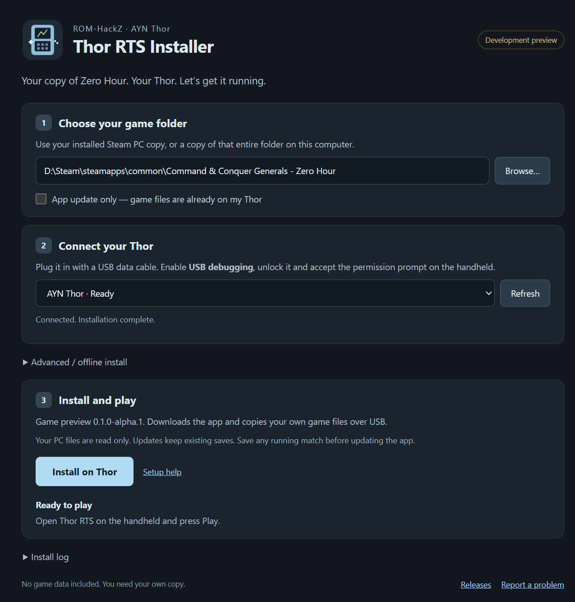

# Install Thor RTS on your AYN Thor

The desktop installer does the fiddly part: it gets the app, copies your own
game files over USB, and checks that they arrived intact. You pick a folder and
a device, then press **Install on Thor**.

**[Download the installer](https://github.com/ROM-HackZ/generals-zero-hour-ayn-thor/releases/tag/installer-v0.1.0)**



## What you need

- An AYN Thor and a USB **data** cable.
- Your own PC installation of Zero Hour. The Steam edition is the one tested.
- Windows 10/11 x64, macOS 13 or newer (Intel or Apple Silicon), or a Linux x64
  desktop. No Python, Node, Android Studio or command-line setup is needed on
  Windows or macOS. Linux may need USB permissions set up once.
- Internet for the first app/USB-tools download. Offline installation is available
  under **Advanced** if you already have the APK and ADB.

The game stays on Android. These downloads are desktop tools for transferring it
to the handheld, not PC or Mac versions of the game. No retail data is included.

## 1. Open the installer

| Computer | Download | Open it |
|---|---|---|
| Windows | `Thor-RTS-Installer-0.1.0-Windows-x64.exe` | Double-click the file. It opens the installer without a separate setup. |
| Apple Silicon Mac | `Thor-RTS-Installer-0.1.0-macOS-arm64.zip` | Unzip it, move **Thor RTS Installer.app** to Applications, and open it. |
| Intel Mac | `Thor-RTS-Installer-0.1.0-macOS-x64.zip` | Same steps, using the Intel download. |
| Ubuntu/Debian x64 | `Thor-RTS-Installer-0.1.0-Linux-x64.deb` | Open it in your package installer, then launch **Thor RTS Installer**. |
| Other Linux x64 | `Thor-RTS-Installer-0.1.0-Linux-x64.tar.gz` | Extract the folder and run `thor-rts-installer` inside it. A normal desktop with GTK 3, NSS, GBM and ALSA libraries is needed. |

These are community builds without trusted publisher certificates. The Mac
bundles have ad-hoc signatures, not an Apple Developer ID or notarization.
Windows may show an unknown-publisher
prompt. On macOS, try opening the app once; if macOS blocks it, go to **System
Settings → Privacy & Security → Open Anyway** for this app. Do this only for the
download from this repository. See [Apple’s instructions](https://support.apple.com/en-us/102445).
The Mac packages are built, but haven't been run on a physical Mac yet. If macOS
reports a damaged app rather than an unknown developer, report the exact message.
Do not disable Gatekeeper globally.

Windows has been checked against the actual Thor. The Linux UI and transfer tests
have been checked in Ubuntu 22.04 under WSL; physical Linux USB access and other
distributions still need testing.

## 2. Choose the game folder

The installer looks for common Steam libraries and suggests a folder if it finds
one. **Browse…** lets you choose it yourself.

In Steam, right-click Zero Hour → **Manage → Browse local files**. Choose that
folder. It should contain:

```text
Command & Conquer Generals - Zero Hour/
    INIZH.big
    ...other .big archives...
    Data/
    ZH_Generals/
        INI.big
        ...other .big archives...
        Data/
```

On macOS, copy this entire folder from your owned PC installation to the Mac
first. On Linux, use that copy or the equivalent Steam/Proton installation.
Keep the original folder names and capitalization. A folder containing just the
Zero Hour archives is not enough: it needs the nested base-game files too.
Other store layouts and modded installations have not been checked.

Your PC files are read only. The installer does not patch the PC game or upload
your game files anywhere.

## 3. Connect the Thor

1. On the Thor, open **Settings → About device** and tap **Build number** seven
   times to enable Developer options.
2. Open **Developer options** and enable **USB debugging**.
3. Connect it to the computer, unlock the handheld, and accept the **Allow USB
   debugging?** prompt on it.
4. Press **Refresh** in the desktop installer. Choose the Thor if more than one
   Android device is connected.

If USB tools are missing, the installer offers to download Android Platform-Tools
from Google. Read [Google’s SDK terms](https://developer.android.com/studio/terms),
tick the agreement box, then press **Refresh**. The tools stay in the installer's
own cache. You can instead choose an existing `adb.exe`/`adb` under **Advanced**.

Linux users whose device shows **no permissions** need USB access rules. On
Ubuntu/Debian, the usual setup is:

```sh
sudo apt install android-sdk-platform-tools-common
sudo usermod -aG plugdev "$USER"
```

Log out and back in after changing groups, reconnect the cable, then refresh.
Other distributions use their own Android udev-rules package.
[Google’s device setup guide](https://developer.android.com/studio/run/device)
explains the USB and permission requirements. WSL does not automatically get
access to a USB device connected to Windows; use the Windows installer there.

## 4. Install and play

Press **Install on Thor**. The installer:

1. Validates the game folder and checks device compatibility/free space.
2. Downloads the published APK and verifies its SHA-256 checksum, or uses the
   local APK you selected under Advanced.
3. Installs or updates Thor RTS, keeping existing app data.
4. Copies the archives and loose `Data` files. Every copied file is staged,
   checksum-verified and then moved into place. Already matching files are skipped.

The tested Steam installation is about **2.7 GB**, so the first transfer can take
a while. Keep the cable connected. The progress bar shows the current step.
If you cancel or disconnect, completed files are kept; reconnect and run the
installer again to resume. A partial file is not used by the game.

When it says **Ready to play**, open **Thor RTS** on the handheld and press
**Play**. Try a skirmish first. [The controls guide](THOR_CONTROLS.md) explains the
wheels and bottom screen.

## Updates and saves

Save a running match before installing an update or replacing game files.
**App update only** skips the game folder and data transfer. It still checks the
USB connection and downloads/verifies the published app. If the same APK is
already installed, the installer skips reinstalling it.

The current installer automatically downloads game preview **0.1.0-alpha.1**.
For the newer [game preview, 0.1.0-alpha.3](https://github.com/ROM-HackZ/generals-zero-hour-ayn-thor/releases/tag/v0.1.0-alpha.3),
download its APK and choose it under **Advanced → Local APK**. Tick **App update
only** if your game files are already installed. Local APKs do not have the
automatic download's pinned checksum; the release provides `SHA256SUMS.txt`.
The same field supports your own builds. Later desktop installer releases can
advance the automatic download without silently selecting arbitrary APKs.

Local saves live on the Thor at:

```text
/sdcard/Android/data/com.generalsthor.zerohour/files/UserData/Command and Conquer Generals Zero Hour Data/Save/
```

Updating the same signed app keeps them. **Uninstalling removes app data**, so
back up that folder first if you plan to uninstall. The installer never
automatically uninstalls the app to fix a signature mismatch.

## If something goes wrong

| Message / symptom | What to try |
|---|---|
| No device | Unlock the Thor, check USB debugging and try another data cable/port. Refresh after accepting the handheld's prompt. Windows may also need the device's OEM USB driver. |
| Unauthorized | Accept **Allow USB debugging?** on the Thor, then refresh. |
| No permissions on Linux | Install your distribution's Android USB rules and check group membership, as above. |
| Wrong game folder | Choose the folder with both `INIZH.big` and `ZH_Generals/INI.big`. |
| Invalid archive | Verify the PC game through Steam, then try again. |
| Checksum mismatch / disconnected | Reconnect and run Install again. Finished files are skipped. |
| Not enough storage | Free space on the handheld and retry. The check accounts for files already transferred. |
| Different signing key | The existing app was kept. Back up saves before deciding to replace it; a local build may use a different key. |
| Blank screen after Play | Wait for startup. If it stays blank, rerun the full transfer check and confirm both games' data is present. |
| Linux tar build won't launch | Check the desktop runtime libraries and your distribution's Electron sandbox policy. The Debian package sets up its sandbox helper. Do not run the app as root or disable its sandbox. |

Open **Install log → Save log…** to keep the result for a bug report. Logs can
contain your local file paths and device serial; review them before sharing.

The older Windows command-line helper remains in `scripts/thor/install-thor.ps1`
for advanced use. The GUI is the recommended route.
